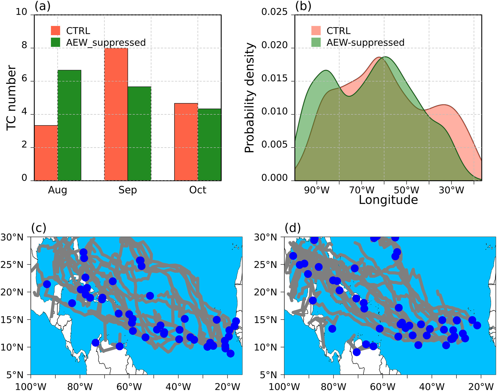
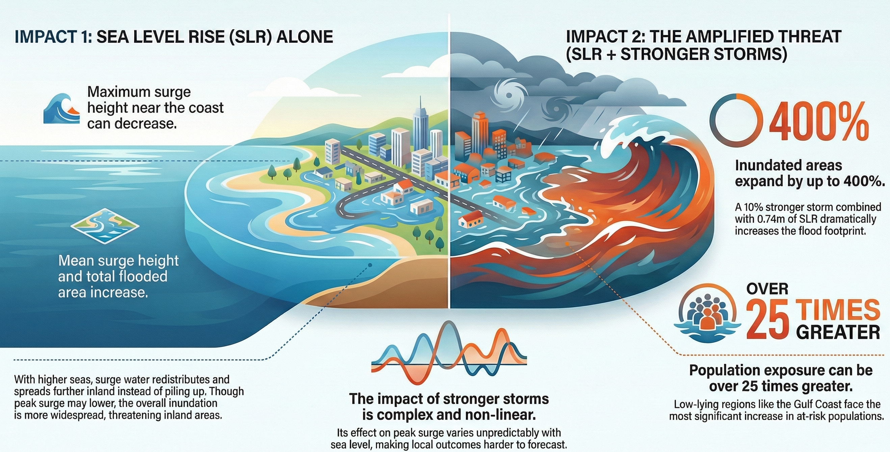

```{=html}
<h1 class="name-heading">Dr Derrick Danso</h1>
```

**Climate Scientist**\
*National Centre for Atmospheric Sciences, University of Reading, United Kingdom*

## About {.about-section}

::::: {.columns .intro}
::: {.column width="30%"}
{width="90%"}
:::

::: {.column width="70%"}
I am a research scientist specialising in climate extremes (their risks and impacts), their drivers, and future changes. My research combines climate modelling, different datasets, and statistical methods to understand extreme events and assess how they may evolve under climate change. 

I also specialise in extreme event attribution, investigating how the likelihood and characteristics of specific extreme events differ between the factual climate and alternative counterfactual climate scenarios representing warmer or cooler conditions, with a particular focus on tropical cyclones and heatwaves.

:::
:::::

## Research Interests

My research focuses on:

-   **Climate extremes** – drivers, variability, and future changes
    -   Tropical cyclones and tropical disturbances
    -   Heatwaves and temperature extremes
    -   Extreme precipitation, windstorms, and atmospheric rivers
    -   Storm surges and compound flooding

-   **Extreme event attribution** – storyline methods including pseudo global warming, reanalysis-based and nudged storylines

-   **Atmospheric and climate dynamics** – large-scale circulation, tropical disturbances, and atmospheric processes

-   **Climate modelling and projections** – high-resolution regional climate modelling, coupled atmosphere-ocean modeling, coastal hydrodynamics modeling

-   **Renewable energy** – solar photovoltaic and wind energy potential, hydropower reservoir management, hydropower flexibility and integration of variable renewable energy sources, climate change impacts on renewable energy potential

## Research Highlights

:::: {.grid .research-item}

::: {.g-col-12 .g-col-md-5}
{fig-alt="Tropical cyclone research" .img-fluid}
:::

::: {.g-col-12 .g-col-md-7}
### African Easterly Waves and Atlantic Tropical Cyclone Activity {.unlisted}

Investigating the influence of African easterly waves (AEWs) on Atlantic tropical cyclone activity using convection-permitting regional climate model simulations. By comparing simulations with and without AEWs, the study examines their influence on tropical cyclone frequency, intensity, genesis timing and location. Results show that AEWs have limited influence on seasonal cyclone numbers but can affect the timing and geographical distribution of genesis, as well as the atmospheric conditions favouring cyclone development.

[Read more](https://eos.org/research-spotlights/linking-african-winds-to-atlantic-storms)
:::

::::

:::: {.grid .research-item}

::: {.g-col-12 .g-col-md-5}
{fig-alt="Storm surge modeling" .img-fluid}
:::

::: {.g-col-12 .g-col-md-7}
### Hurricane Intensification, Sea-Level Rise and Storm Surge {.unlisted}

This work investigated the individual and combined effects of tropical cyclone intensification and sea-level rise on storm surges along the U.S. Atlantic Coast. Storm surge and inundation changes are simulated under different coastal settings. Results highlight the complex and sometimes nonlinear interactions between sea-level rise and cyclone intensity, showing how their combined effects can substantially amplify storm surge and expand coastal flooding, with responses influenced by coastal topography and storm characteristics.

[Read more](https://ocean2climate.org/2025/12/13/why-rising-seas-could-lower-a-hurricanes-peak-surge-but-drown-a-wider-area/)
:::

::::


## Contact me

📧 Email: d.k.danso\@reading.ac.uk / derrickkdanso\@gmail.com

🔗 [Google Scholar](https://scholar.google.com/citations?user=J22RDVEAAAAJ&hl=en)

🔗 [ORCID](https://orcid.org/0000-0001-7141-7530)

🔗 [ResearchGate](https://www.researchgate.net/profile/Derrick-Danso?ev=hdr_xprf)